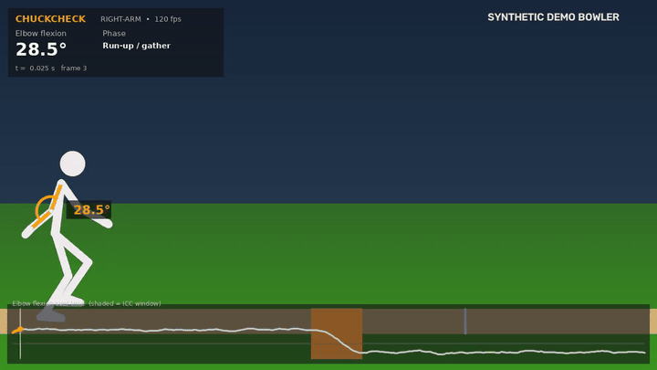
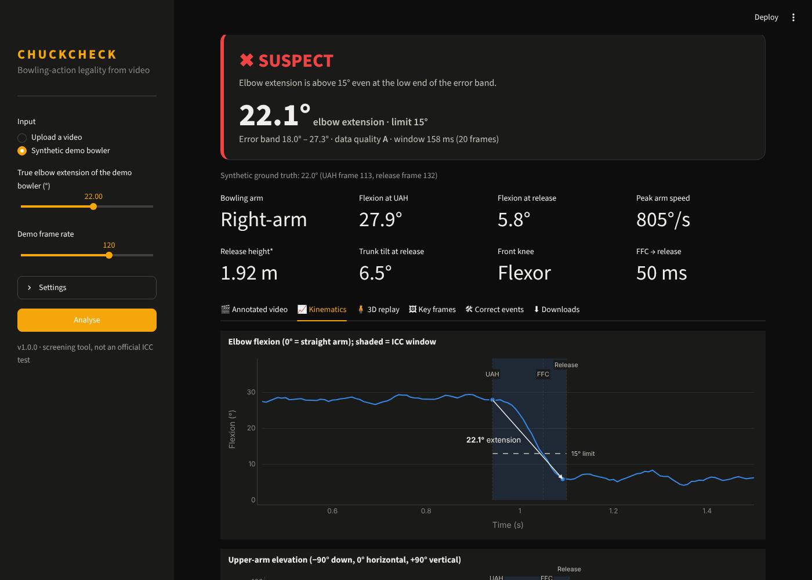
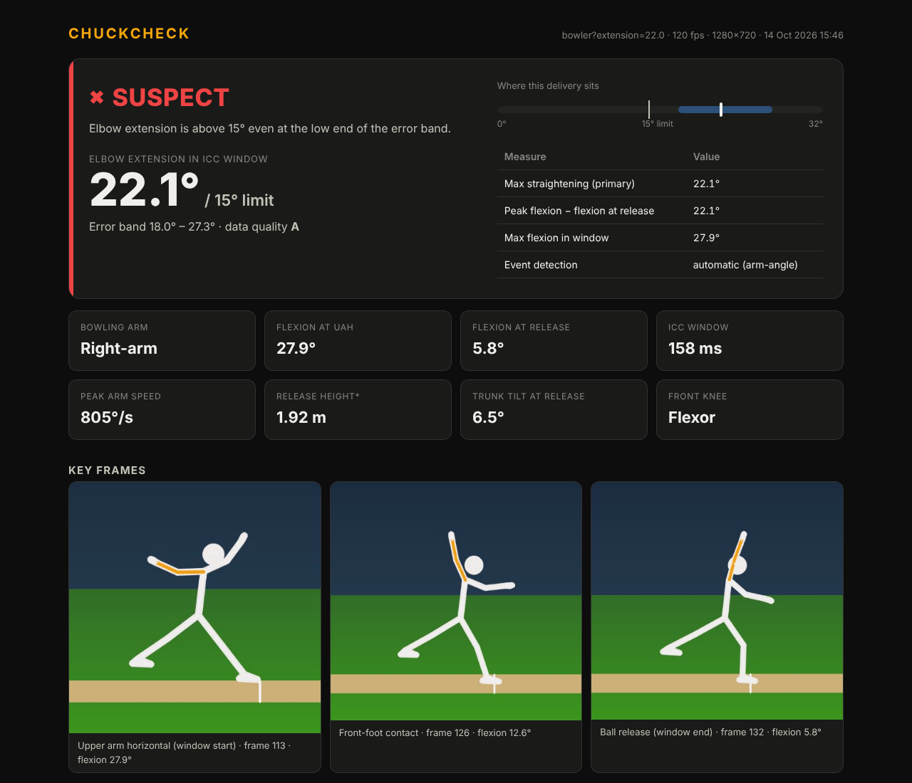
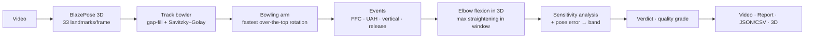

<div align="center">

# 🏏 ChuckCheck

**Is that bowling action legal? Measure elbow extension from a single phone video.**

[](https://github.com/YOUR_USERNAME/chuckcheck/actions)




</div>

---

Cricket's laws allow a bowler's elbow to **straighten by at most 15°** between the moment the upper arm
reaches horizontal and the moment the ball is released (ICC regulations). Today the check happens in a few
accredited biomechanics labs with marker-based motion capture, so club, school and academy bowlers rarely get tested.

**ChuckCheck** brings a screening version of that test to any phone video. It reconstructs the bowler in 3D,
finds the ICC measurement window on its own, measures how much the elbow straightens inside it, and reports
a verdict **with an honest error band**. You also get a broadcast-style slow-motion video, interactive
charts, a rotatable 3D replay and a shareable report card.

> ⚠️ ChuckCheck is a coaching and screening tool, **not** an official ICC assessment.

## ✨ Features

| | |
|---|---|
| 🧍 **3D pose** | MediaPipe BlazePose gives 33 landmarks per frame in image space and in metric 3D. The bowler is tracked even when the umpire or batter is in shot. |
| 🎯 **Automatic ICC window** | Detects the bowling arm, **upper-arm-horizontal (UAH)**, arm-vertical, **ball release** and **front-foot contact** from the kinematics. |
| 📐 **Elbow extension** | Largest straightening of the elbow inside UAH → release, computed in 3D (independent of camera angle). |
| 📊 **Error band & verdict** | Sensitivity analysis (smoothing, ±10 ms event timing) plus the assumed pose error. Verdict: `LEGAL`, `LIKELY LEGAL`, `BORDERLINE` or `SUSPECT`, with a data-quality grade from A to C. |
| 🎬 **Annotated slow-mo video** | Skeleton overlay, live elbow-angle arc, phase labels, event flashes, a running timeline and a verdict card at the end. |
| 🧊 **3D replay** | Rotate and scrub the delivery in 3D (Plotly). |
| 🏃 **Extra biomechanics** | Peak arm angular speed, release height, trunk tilt, front-knee action (braced, flexor, extender), FFC → release time. |
| 🧪 **Multiple deliveries** | Every ball in a clip is analysed separately. |
| 🛠 **Manual correction** | Override the UAH or release frame and re-analyse in milliseconds (pose is cached). |
| 📦 **Three interfaces** | Streamlit web app, CLI and Python API. Exports JSON, CSV, MP4 and a self-contained HTML report. |
| ✅ **Validated** | A synthetic bowler with *known* extension checks the whole measurement chain in CI. |

## 🚀 Quick start

```bash
git clone https://github.com/YOUR_USERNAME/chuckcheck.git
cd chuckcheck
python -m venv .venv
# Windows: .venv\Scripts\activate      macOS/Linux: source .venv/bin/activate
pip install -r requirements.txt
```

> Python **3.10–3.12** is recommended. On first use the pose model (~9 MB for `full`, ~30 MB for `heavy`)
> downloads automatically to `~/.cache/chuckcheck/models`.

### 1. Try it with no video (synthetic bowler)

```bash
python -m chuckcheck demo --extension 22
```

### 2. The web app

```bash
streamlit run app.py
```

Upload a clip (or pick **Synthetic demo bowler**), press **Analyse**, then explore the tabs: annotated video,
kinematics, 3D replay, key frames, manual correction and downloads.



### 3. The command line

```bash
python -m chuckcheck analyze my_delivery.mp4                    # → runs/my_delivery/
python -m chuckcheck analyze clip.mp4 --model heavy --arm right # more accurate model, force right arm
python -m chuckcheck reanalyze runs/clip --uah 212 --release 236 # fix event frames by hand (no re-inference)
python -m chuckcheck download-models                             # pre-fetch the models (offline use)
```

Each run folder contains:

| File | What it is |
|---|---|
| `annotated.mp4` | Slow-motion overlay video with the verdict card |
| `report.html` | Self-contained report card (works offline, easy to share) |
| `analysis.json` | Every event, measurement, metric and setting |
| `timeseries.csv` | Per-frame elbow flexion, upper-arm elevation and arm speed |
| `keyframe_*.jpg` | Annotated front-foot-contact, UAH and release frames |
| `pose.npz` | Cached landmarks, so `reanalyze` is instant |



### 4. Python API

```python
from chuckcheck import AnalysisConfig
from chuckcheck.runner import run_video

res, paths = run_video("delivery.mp4", "runs/delivery", AnalysisConfig(model="heavy"))
lg = res.primary.legality
print(lg.verdict, lg.extension_deg, (lg.band_low_deg, lg.band_high_deg))
```

## 🎥 How to film for a good result

1. **Frame rate matters most.** Use your phone's slow-motion mode (**120 or 240 fps**). The UAH-to-release window lasts only
   ~80–150 ms, which is just 3–4 frames at 30 fps.
2. **Side-on to the bowling arm**, about 8–15 m away, camera at chest height and **still** (tripod or resting on something).
3. The **whole body** should be in frame from back-foot contact to follow-through.
4. Good light, contrasting clothes, and no one standing between the camera and the bowler.

## 🧠 How it works



* **Elbow flexion** = 180° − ∠(shoulder, elbow, wrist) in 3D world coordinates, so 0° means a straight arm.
* **Upper-arm elevation** = angle of the shoulder→elbow vector above the horizontal plane (−90° hanging, +90° vertical).
* **UAH** = last upward crossing of 0° elevation before the arm's highest point.
* **Release** ≈ the moment the upper arm has rotated *N*° (default 15°) past its highest point. The alternative is the peak in wrist speed. You can always correct it by hand.
* **Extension** = the largest decrease in flexion from any frame to any later frame inside [UAH, release].
  ChuckCheck also reports the simpler *peak flexion − flexion at release*.
* **Error band** = the 10th–90th percentile over 27 perturbed re-measurements (smoothing ×0.6/1.0/1.4, UAH ±10 ms, release ±10 ms), widened by
  the assumed systematic pose error (default ±4°).

| Verdict | Rule |
|---|---|
| ✔ `LEGAL` | the whole band is ≤ 15° |
| ✔ `LIKELY LEGAL` | estimate ≤ 15°, but the band crosses 15° |
| ⚠ `BORDERLINE` | estimate > 15°, but the band includes legal values |
| ✖ `SUSPECT` | even the low end of the band is > 15° |

More detail in [`docs/METHOD.md`](docs/METHOD.md).

## ✅ Validation

`scripts/validate_synthetic.py` builds synthetic bowlers with known elbow extension (0–35°, left and right arm, with landmark noise)
and runs the full analysis on them:

| Frame rate | Mean abs. error | Max error | Truth inside error band | Cases |
|---|---|---|---|---|
| 240 fps | 0.69° | 1.81° | 100% | 32 |
| 120 fps | 0.53° | 1.77° | 100% | 32 |
| 60 fps | 1.49° | 3.52° | 100% | 32 |
| 30 fps | 2.19° | 5.92° | 97% | 32 |

This checks the measurement chain: smoothing, events, the extension maths and the band. It does **not** measure the error of the
pose model on real people. That needs ground truth from a motion-capture lab. Published comparisons of monocular pose against
marker-based capture typically report joint-angle errors of several degrees, which is why the band includes a pose-error term.

## 🗂 Project structure

```
chuckcheck/
├── app.py                  # Streamlit web app
├── chuckcheck/
│   ├── pose.py             # MediaPipe PoseLandmarker → PoseSequence (+ person tracking)
│   ├── filters.py          # gap filling, Savitzky–Golay smoothing
│   ├── kinematics.py       # angles, bowling-arm detection, delivery & event detection
│   ├── legality.py         # ICC extension, sensitivity band, verdict, quality grade
│   ├── pipeline.py         # end-to-end analysis + biomechanics metrics
│   ├── render.py           # annotated slow-mo video
│   ├── plots.py            # Plotly charts + 3D replay
│   ├── report.py           # HTML report card, JSON, CSV, key frames
│   ├── synthetic.py        # synthetic bowler with known ground truth
│   ├── runner.py / cli.py  # high-level API and command line
│   └── models.py           # model download & cache
├── tests/                  # pytest suite (runs in CI)
├── scripts/validate_synthetic.py
└── docs/METHOD.md
```

## 🧭 Limitations and roadmap

- Monocular 3D pose is less accurate than calibrated multi-camera marker capture, and forearm rotation can be confused with elbow flexion in some views.
- Release detection is kinematic. A ball tracker (e.g. YOLO `sports ball` + hand distance) would pin it down exactly.
- Roadmap: ball tracking for release, a two-phone stereo mode, fine-tuning a 3D lifter (MotionBERT) on bowling clips, a
  front-foot no-ball checker (crease detection), and a mobile app.

## 🙏 Acknowledgements

[MediaPipe](https://developers.google.com/mediapipe) (BlazePose), [Plotly](https://plotly.com/python/),
[Streamlit](https://streamlit.io), and the sports-biomechanics research behind the ICC's 15° protocol.

## 📄 License

MIT. See [LICENSE](LICENSE).
